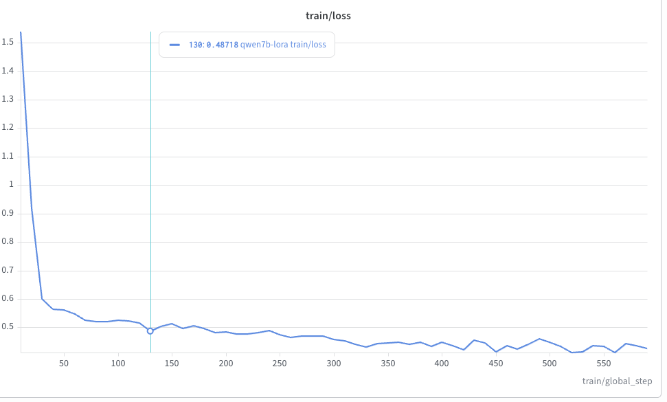
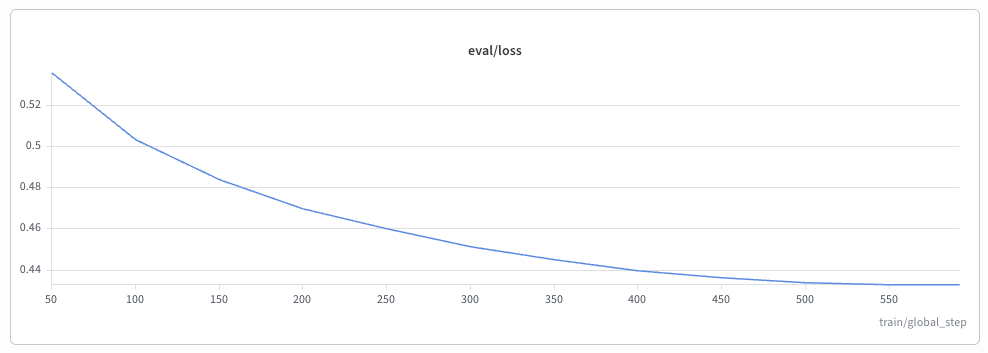
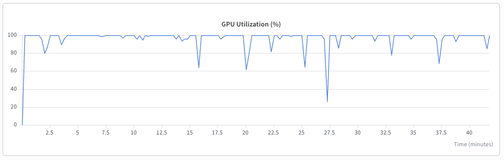

# 2. Multi-node fine-tuning: Qwen2.5-7B for function calling

## Goal

- Teach an LLM to **call tools reliably**: pick the right function, fill the arguments correctly, make parallel calls, and know when *not* to call.
- Run it as a **distributed Slurm job across 2 nodes × 1 H100** on Soperator, with **> 80 % GPU utilisation**.
- Prove it worked with a **before/after benchmark** on held-out data.

## Model: `Qwen/Qwen2.5-7B-Instruct`

- **Apache-2.0 and ungated**, so a commercial startup can ship it.
- **Big enough to keep an H100 busy** (> 80 % target) and realistic for a production agent, yet it fits on one GPU with LoRA.
- **Native tool-calling chat template**, which supports parallel calls.
- **Smoke test first with Qwen2.5-1.5B** (same template): it proves the pipeline in about 2 minutes.
- **Trade-offs:**
  - Qwen2.5-3B was rejected because its licence is research-only (non-commercial).
  - Llama 3.x was rejected: gated, with a different tool-call format.
  - 14B was the stretch option.

## Why LoRA

- **Without LoRA (full fine-tune):** ~16 bytes per parameter × 7.6 B ≈ **~120 GB per GPU**. That doesn't fit in 80 GB, so it would need FSDP. It would also sync **~15 GB of gradients per step**, about 14 s at 1.1 GB/s, leaving the GPUs mostly idle.
- **With LoRA:**
  - The base model is frozen in bf16, taking **~15 GB**.
  - Only small adapters train: **40 M parameters (0.5 %)**, about 0.6 GB including optimizer state.
  - Measured **~40 GB of 80 GB** used per GPU.
- **Network:** only the adapter gradients (~100–150 MB) cross the wire each step, taking about 0.1 s, overlapped with the backward pass.
- **Fits the task:** function calling teaches a *format and behaviour*, not new knowledge. That is where LoRA comes close to full fine-tuning.
- **Settings:** `r=16`, `alpha=32`, `dropout=0.05`, all linear layers (attention + MLP).
- **Trade-off:** a lower quality ceiling than full fine-tuning, which doesn't matter for this task. The adapter checkpoint is only 155 MB.

## How the distributed training works (DDP)

- **PyTorch DDP:** each GPU holds a full copy of the model and trains on a different slice of the data.
  - After each backward pass, NCCL **all-reduces** (averages) the adapter gradients across the 2 nodes, so both copies stay identical.
- **Launch:** Slurm starts one `torchrun` per node. The nodes meet at a rendezvous on the first node's IP (`c10d`).
- **Network:** no InfiniBand, so NCCL uses TCP on `eth0` (`NCCL_IB_DISABLE=1`, `NCCL_SOCKET_IFNAME=eth0`).
- **Shared filesystem:** model, dataset, Python environment and checkpoints are all on the shared jail (`/data`, `/opt/venvs`), so both nodes read the same files with no internet access (`HF_HUB_OFFLINE=1`).
- **Why DDP and not FSDP:** FSDP saves memory, which LoRA already solves. FSDP would move far more data over the network, and the network is the bottleneck here.
- **Stack:** Hugging Face TRL `SFTTrainer` + PEFT. It's standard and readable, which makes it easy for the customer to change.

## Dataset: `Team-ACE/ToolACE` (Apache-2.0)

- **11,300 conversations** with tool schemas, tool calls (including parallel calls) and tool results.
- **Why the original:** a "cleaned" derivative on Hugging Face had lost arguments, parallel calls and exact tool names (~1/3 of sampled labels were wrong). It was rejected in favour of the original.
- **Cleaning:** converted to Qwen's native tool-call format, validated each call against its tool schema, and dropped duplicates, non-standard calls, rows without tools and over-long conversations.
- **Result:** 11,300 → **10,514 conversations**, **18,143 tool calls**, 4,125 parallel-call turns.
- **Split:** 90 % train / 5 % validation / 5 % test.

| Split | Conversations | Used for |
|---|---|---|
| Train | 9,462 | Fine-tuning |
| Validation | 526 | `eval_loss` every 50 steps (watching for overfitting) |
| Test | 526 (725 scored turns) | Before/after benchmark; never seen in training |

- **Trade-off:** 90/5/5 instead of 80/10/10, because the dataset is small. 725 test turns are still enough for stable percentages.

## Running the job

| Step | Command (on the login node) |
|---|---|
| Set up environment (once) | `cd ~/training && bash setup_train_env.sh` |
| Download models (once) | `cd ~/eval && bash download_models.sh` |
| Pipeline test (1.5B, 30 steps) | `sbatch --export=ALL,MODEL=/data/models/Qwen2.5-1.5B-Instruct,RUN=test-1.5b,MAX_STEPS=30 train.sbatch` |
| **7B training** | `cd ~/training && sbatch --export=ALL,RUN=qwen7b-lora,WANDB=1 train.sbatch` |
| Monitor | `squeue`, `tail -f train-lora-<job>.out`, `srun --jobid=<job> --overlap nvidia-smi`, W&B |

- **Training settings:**
  - 2 epochs, learning rate `1e-4` with cosine decay.
  - Batch of 8 per GPU × 2 accumulation steps × 2 GPUs = **32 conversations per update**.
  - bf16 and gradient checkpointing.
- **Checkpoints** every 100 steps. Resubmitting with the same `RUN` name resumes from the last checkpoint, which protects against node maintenance.
- **Result (job 44):**
  - **43 min 44 s**, 592 steps, 7.5 conversations/s.
  - **GPU 96–100 % on both nodes.**
  - Train loss 1.54 → 0.43. **Validation loss fell at every check, 0.536 → 0.433**, so no overfitting.

### Training curves (Weights & Biases, job 44)

**Training loss**

- The loss drops fast in the first ~30 steps (1.5 → 0.6) as the model picks up the tool-call format. It then declines slowly to ~0.42 as it learns the finer details.

**Validation loss**

- Validation loss, measured on data the model never trains on, falls at every check (0.536 → 0.433) and levels off near the end. The model is learning, not memorising.

**Learning rate**

- Short warm-up to `1e-4` in the first ~18 steps, then cosine decay to 0. Smaller steps near the end explain why both loss curves flatten.

**GPU utilisation (worker-0)**

- Close to **100 % for the whole 43-minute run**, well above the 80 % target. The short dips are the periodic validation and checkpoint pauses.

## Evaluation: before vs after

- **Method:**
  - vLLM batch inference on the **725 test turns**, greedy decoding.
  - Same prompts for the base model and for base + LoRA adapter.
  - The scorer compares the **set** of calls, so parallel calls are handled.
- **Commands:**
  - Before: `cd ~/eval && sbatch --export=ALL,RUN=base-7b eval.sbatch`
  - After: `sbatch --export=ALL,RUN=lora-7b,LORA=/data/checkpoints/qwen7b-lora/adapter eval.sbatch`
  - Compare: `python compare.py /data/eval-runs/base-7b/metrics.json /data/eval-runs/lora-7b/metrics.json`

| Metric | Base | Fine-tuned | Change |
|---|---|---|---|
| **Exact match** (name + all arguments) | 56.4 % | **68.2 %** | **+11.8 pts** |
| … single call / parallel calls | 67.3 / 40.2 % | 79.9 / 50.8 % | +12.6 / +10.6 |
| Right tool chosen | 87.6 % | 91.1 % | +3.5 |
| **Correctly answered without a tool** | 60.3 % | **78.0 %** | **+17.7** |
| Malformed tool call | 0.4 % | 0.4 % | 0 |

- **What improved:**
  - Calls with unrequested extra arguments fell from **120 to 31**.
  - The model stopped calling tools after already giving the answer.
- **Remaining errors:** mostly label-style mismatches, such as `"living room"` vs `"Living Room"`, which exact match counts as wrong.

## Challenges

- **The data needed clean-up to get correctly formatted training examples:** the "cleaned" Hugging Face copy had wrong labels, and tool-call arguments were double-encoded (quoted JSON strings). Rebuilt from the original ToolACE and checked against Qwen's chat template.
- **Training crashed at start-up:** `warmup_ratio` was removed in transformers 5. Switched to `warmup_steps` and pinned the library versions.
- **The rendezvous picked `docker0`** (169.254.0.1) instead of `eth0`. Now the IP is resolved with `getent hosts`.
- **The vLLM eval job never exited** after finishing, holding the GPU. Fixed with an explicit exit.
- **W&B showed the successful run as failed** because of an unclean shutdown. Cosmetic; fixed for later runs.

## Next steps

- **Tune hyperparameters one change at a time**, picking the winner by validation loss:
  - 3 epochs, since validation loss was still falling;
  - learning rate 2e-4;
  - `r=32`.
- **Train on assistant turns only**, which needs a patch to the chat template.
- **For production scale on 8-GPU InfiniBand nodes:** same script, more nodes. Move to FSDP `HYBRID_SHARD` only for full fine-tuning or models above ~13B.
